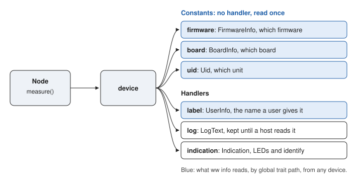

# A device that tells about itself

A device on a bench, in a rack or at a customer's site gets asked the same questions again and again. Which firmware
does it run? Which board is it, which revision, which unit? What did it log before it went wrong? The
[[device contract]] is the part of the standard library that answers them: six traits that every device should
offer, whatever else it does.

This page builds a sensor node that offers them. It then asks the node from Rust, from `ww` and from Python, with
code that works the same on any other device that offers the contract.

The example has three crates. [`examples/node_api/src/lib.rs`] holds the API, `node_device` the device code, and
`node` the host program and the simulated device. Start the simulated device in a terminal of its own:

```sh
cargo run -p node --example node_sim
```

It prints `node at ws://127.0.0.1:8083/ww`, the address the host programs below connect to.

## The contract in one subtree

The contract's traits go into one subtree of the API, by convention a trait named `Device`:

```rust
--8<-- "examples/node_api/src/lib.rs:device"
```

Each line answers one question:

| Item | Trait | Answers |
|---|---|---|
| `firmware` | `ww_firmware_info::FirmwareInfo` | Which firmware and version, built when, and its build id. |
| `board` | `ww_board_info::BoardInfo` | Which board, which revision and how the firmware knows it, which serial number. |
| `uid` | `ww_uid::Uid` | Which unit: the chip's unique id, a MAC address or another id. |
| `label` | `ww_user_info::UserInfo` | Which name a user gave the unit, such as "bench 2". |
| `log` | `ww_log::LogText` | What the device logged, also before a host connected. |
| `indication` | `ww_indication::Indication` | What the status LEDs show, and a blink that finds the unit on a bench. |

The API root puts the subtree beside what the node does itself, here one method:

```rust
--8<-- "examples/node_api/src/lib.rs:root"
```

The subtree can sit at any depth and under any name. A host finds each trait by its [[global trait path]], as it
found `ww_gpio::Bank` in [Using the standard library](using.md). The figure shows the node's subtree and which of its
traits `ww info` reads.



## What never changes is a constant

The firmware, the board and the unit's id don't change while the device runs. Their traits declare them as `const`
items, and a device gives their values in an implementation of the `NodeConsts` trait that `ww_codegen!` generates.
The generated code answers a read of a constant by itself, with no handler:

```rust
--8<-- "examples/node_device/src/lib.rs:consts"
```

The names join the path of each constant: `DEVICE_FIRMWARE_FIRMWARE` is `FIRMWARE` of `firmware` in `device`. A real
firmware fills `FirmwareSummary` from its build, as [`ww_firmware_info`](ww_firmware_info.md) describes, and its unique
id from the chip. `BUILD_ID` names the firmware's ELF file for the host tools that decode logs and crashes; the
simulated node has none.

## The label and the log have handlers

The label is a property that a user writes, so it has a read and a write handler. The node keeps it in RAM, which
`CAPABILITIES.persistent: false` tells hosts:

```rust
--8<-- "examples/node_device/src/lib.rs:label"
```

The log is a reliable stream of `LogRecord`s. **Reliable** means that the device keeps each record in a store until a
host acknowledges it. A host that connects later still gets what the device logged before, and nothing is lost across
a reconnect. The node logs through one function:

```rust
--8<-- "examples/node_device/src/lib.rs:log"
```

It logs `booted` when it starts and one record per call of `measure()`:

```rust
--8<-- "examples/node_device/src/lib.rs:measure"
```

A device leaves out the optional items it doesn't have, here the notes of the label, the reworks of the board and the
brightness of the LEDs. The host sees them as left out in the introspection data:

```rust
--8<-- "examples/node_device/src/lib.rs:codegen"
```

## From the command line

`ww info` asks any device the contract's questions. It needs nothing of the device's own API: it reads each trait by
its global trait path and says so when a device doesn't offer one.

```ww
--8<-- "docs/generated/node/info.txt"
```

`API` and `Hello` describe the connection: the API crate and its wire version, and the protocol generations both
sides agreed on. The rest comes from the contract. The label is empty until a user names the unit. `Last reset`
comes from `ww_firmware_info::LastReset`, which records why a device last reset, with a crash's registers. The node
doesn't offer it, and `ww info` says so instead of failing.

`ww introspect` shows the subtree with the value of each constant:

```ww
--8<-- "docs/generated/node/introspect.txt"
```

## From Rust

The host program [`examples/node/examples/about.rs`] reads the constants through the generated [[client]]. Each
constant has a `read_` call named after it:

```rust
--8<-- "examples/node/examples/about.rs:about"
```

It names the unit and reads the name back:

```rust
--8<-- "examples/node/examples/about.rs:label"
```

Last, it makes the node log a reading and reads the log from its start. `records_status()` says which session the log
is in, and `records_resume()` opens the stream at a position of that session, here 0:

```rust
--8<-- "examples/node/examples/about.rs:log"
```

Run the program in a second terminal, while the simulated device runs in the first:

```sh
cargo run -p node --example node_about
```

It prints the firmware, the board, the id and the name. Then it prints `#1 ... reading 1: 21.50 °C` before
`#0 at 0.000 s, Info: booted`. The newest record comes first, as the stream's live run. The records the host missed
follow as the backfill, each at its position, so a program that sorts by position sees the log in order.

## From Python

Python reads a constant like a property, with `read()`. A struct is a `dict`:

```python
--8<-- "examples/stdlib_py/node.py:about"
```

The label is a property like any other:

```python
--8<-- "examples/stdlib_py/node.py:label"
```

`identify(duration)` blinks the unit's LEDs so that you can find it on a bench. A second call while the first runs is
refused with the common error `Busy`:

```python
--8<-- "examples/stdlib_py/node.py:identify"
```

The whole script is [`examples/stdlib_py/node.py`]. With the simulated device running, it prints:

```text
--8<-- "docs/generated/node/node_py.txt"
```

## On a real board

A firmware serves the same contract, with real values for its constants. The RP2350 board example
`examples_mcu/rp2` logs through `ww_log::LogDefmt`, the compact form of the log that the firmware's ELF file decodes
on the host. The [device contract reference](device_contract.md) shows how a firmware reports its build id, how `ww`
finds the ELF file for it, and what `ww report` collects for a bug report.

## Where to go next

- [Changing your API](../evolution/overview.md) shows how to add to an API so that old hosts and old firmware keep
  working.
- The [list of crates](overview.md) describes every crate of the standard library, the contract's included.
