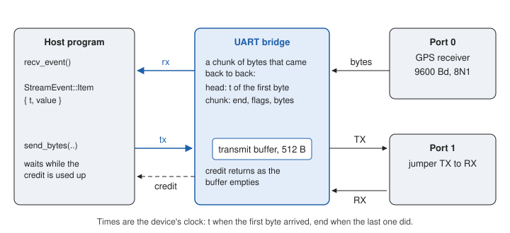

# A UART bridge

A UART bridge connects a serial device to a computer: what the device sends arrives on the computer, and what the
computer sends goes out on the serial line. This page builds one from the standard trait `ww_uart::Uart`. Unlike the
[GPIO expander](gpio_expander.md), it moves bytes continuously in both directions, so it uses a [[stream]] for
received bytes and a [[credit sink]] for bytes to send.

The example has three crates. [`examples/uart_api/src/lib.rs`] holds the API, `uart_device` the device code, and
`uart` the host program and the simulated device. Start the simulated device in a terminal of its own:

```sh
cargo run -p uart --example uart_sim
```

It prints `uart at ws://127.0.0.1:8082/ww`, the address the host programs below connect to.

## The API

The API is one line, an array of standard serial ports:

```rust
--8<-- "examples/uart_api/src/lib.rs:api"
```

`ww_uart::Uart` has eight items. The ones this page uses are `configure`, which sets the line, `rx`, the stream of
received bytes, and `tx`, the sink of bytes to send. The [`ww_uart`](ww_uart.md) page describes the rest.

## Two ports on a simulated board

The device code asks a `Board` for its ports, as the GPIO expander does. A board configures a port, sends bytes out
of it, and hands over the bytes it received in chunks:

```rust
--8<-- "examples/uart_device/src/lib.rs:board"
```

A **chunk** is a run of bytes that arrived back to back, such as one line of a protocol. The board says when its
first and its last byte arrived, on the device's clock. The simulated board has a serial device on each port:

```rust
--8<-- "examples/uart_device/src/sim.rs:sim"
```

NMEA sentences are the text lines most GPS receivers send. The loopback on port 1 lets you test sending without a
second device.

## Received bytes go up a stream

The GPIO expander only answered requests. A UART bridge also has work of its own: bytes arrive whenever the GPS
receiver sends them. The device's event loop therefore waits for two things at once, the next request and the next
chunk the board completes:

```rust
--8<-- "examples/uart_device/src/lib.rs:serve"
```

`server.wait_until(at)` returns either a request or, at `at`, a due wake-up. On a wake-up the loop sends each
completed chunk up the `rx` stream of its port:

```rust
--8<-- "examples/uart_device/src/lib.rs:send"
```

`rx` is a counted stream: each event carries its position, counted in bytes, and the time of the chunk's first byte.
A host that misses bytes, because nobody listened or the link dropped them, learns exactly how many it missed. The
chunk itself carries the time of its last byte, and `flags` reports line errors. The figure shows both directions.



## Bytes to send go down a credit sink

A host can produce bytes much faster than a serial line sends them. If the host sent them all at once, the device's
transmit buffer would overflow. The `tx` sink prevents this with credit: the device grants the host as many bytes as
its buffer holds, 512 here, and the host never sends more than its credit. The device returns credit as bytes leave
the buffer:

```rust
--8<-- "examples/uart_device/src/lib.rs:tx"
```

The simulated board sends each write at once, so the handler returns the credit at once. A firmware returns it when
its UART has taken the bytes out of the buffer.

## Configuring the line

A port is configured with one call that sets the whole line: baud rate, data bits, parity, stop bits and mode. The
answer is the configuration actually set, so a host sees the baud rate the hardware settled on:

```rust
--8<-- "examples/uart_device/src/lib.rs:configure"
```

The simulated board refuses what a real port of its kind can't do, such as flow control or a baud rate above 1 MBd,
with `CommonError::Unsupported`. Its ports start at 115 200 Bd. The GPS receiver sends at 9600 Bd, so its bytes
arrive garbled and flagged as framing errors until port 0 is configured to match.

## From Rust

The host program [`examples/uart/examples/bridge.rs`] first configures port 0 for the GPS receiver:

```rust
--8<-- "examples/uart/examples/bridge.rs:configure"
```

It then opens `rx` and prints two sentences. `recv_event()` returns the stream's events with their heads:
`StreamEvent::Item` holds a chunk and the time `t` of its first byte, and a `StreamEvent::Gap` would say how many
bytes were lost:

```rust
--8<-- "examples/uart/examples/bridge.rs:rx"
```

Last, it opens `rx` and `tx` of port 1, sends a line and reads it back through the jumper. `send_bytes` waits while
the credit is used up:

```rust
--8<-- "examples/uart/examples/bridge.rs:loopback"
```

Run the program in a second terminal, while the simulated device runs in the first:

```sh
cargo run -p uart --example uart_bridge
```

It prints `port 0: 9600 Bd`, two sentences one second apart, and `port 1: hello, loopback`. Configuring port 0
restarts the simulated receiver, so the sentences always start at 12:00:01.

## From Python

In Python, a struct argument is a `dict` of its fields, and a number with a unit is its value in the base unit, here
bauds:

```python
--8<-- "examples/stdlib_py/uart.py:configure"
```

A stream and a sink are opened with `with`, which closes them at the end of the block. `recv(timeout=3)` returns the
next chunk as a `dict`:

```python
--8<-- "examples/stdlib_py/uart.py:rx"
```

A sink has `send(bytes)`, which waits for credit as `send_bytes` does in Rust:

```python
--8<-- "examples/stdlib_py/uart.py:loopback"
```

The whole script is [`examples/stdlib_py/uart.py`]. With the simulated device running, it prints:

```text
--8<-- "docs/generated/uart/uart_py.txt"
```

## What `ww` shows

`ww introspect` shows the standard trait under `uart[]`, as for the GPIO expander:

```ww
--8<-- "docs/generated/uart/introspect.txt"
```

`monitor` is marked `left out by this device`. It is an optional item of `ww_uart::Uart`, which watches a link
between two other devices, and the simulated board has no hardware for it. The device leaves it out with
`omit = ["uart.monitor"]` in its `ww_codegen!` call, and every host sees that the item is missing:

```rust
--8<-- "examples/uart_device/src/lib.rs:codegen"
```

## On a real board

The STM32H725IG board example serves the same API over USB, with UART7 and UART8 as its two ports. Flash it with
the runner of its `.cargo/config.toml`:

```sh
cd examples_mcu/usb_stm32h725ig
cargo run --release --features streams --bin stm32h725ig-uart
```

Its ports run at a fixed 115 200 Bd and send what they receive up `rx`, timed by the UART's idle interrupt. The
example [`examples/uart/examples/simple.rs`] sends a few bytes to port 0 over USB.

## Where to go next

- [A device that tells about itself](device_info.md) adds the standard traits every device should have: firmware
  and board information, a unique id, and a log.
- [`ww_uart`](ww_uart.md) describes every item of `Uart`, how to time each byte of a chunk, and the `monitor`
  stream.
