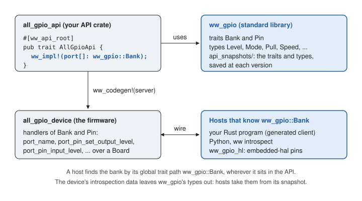

# Using the standard library

Many devices offer the same things: pins to read and drive, a serial port to bridge, a firmware version to report,
a log to read. The [[standard library]] has a ready-made [[API trait]] for each of them. A device puts such a trait
into its own API with one line, serves it with [[handlers]] like any trait of its own, and every host tool that knows
the trait works with the device at once.

This page shows what the standard library holds and how a device API is built from it. The next pages build three
devices from it, each simulated on your PC first: a [GPIO expander](gpio_expander.md), a
[UART bridge](uart_bridge.md) and a [device that tells about itself](device_info.md).

## What it holds

The standard library is a set of crates, one per subject. Each crate holds traits, their types, and a saved
description of both, its [[snapshot]]. The crates fall into three groups:

| Group | What a device uses it for | Crates |
|---|---|---|
| I/O | Hardware it offers over the wire: pins, serial ports, buses, converters | `ww_gpio`, `ww_uart`, `ww_i2c`, `ww_spi`, `ww_can_bus`, `ww_adc`, `ww_pwm`, ... |
| [[device contract]] | What every device tells about itself: firmware, board, unit, log | `ww_firmware_info`, `ww_board_info`, `ww_uid`, `ww_user_info`, `ww_log`, `ww_indication` |
| Data types | Numbers with units, errors and dates inside your own traits | `ww_si`, `ww_error`, `ww_date_time` |

The [list of crates](overview.md) names every crate with its traits. This part of the book uses the first trait of
each of the first two groups; [Numbers that know their unit](ww_si.md) covers the data types.

## Why a standard trait

You could write your own trait for pins, with a method to set a level and one to read it. It would work, but only
with the host programs you write for it. A standard trait gives you the other side for free. A trait from the
standard library brings three things with it:

- **Hosts that already know it.** The `ww` tool, Python and helper crates such as `ww_gpio_hl` find a standard
  trait wherever it sits in a device's API, and call it without any code of yours.
- **Conventions you don't have to invent.** A bus is configured in one call that answers with what was actually set.
  A number carries its unit. An error says whether the device lacks the feature or is busy.
- **A smaller device.** A device sends a description of its API to each host that connects, its [[introspection]]
  data. The types of a standard crate are left out of it, because hosts already have them from the crate's snapshot.

## Putting a trait into your API

A standard trait goes into an API trait with `ww_impl!`, as a trait of your own does
([Traits](../api/traits.md)). The GPIO expander of the next page offers every pin of a board, grouped in banks as on a
microcontroller. Its whole API is one line:

```rust
--8<-- "examples/all_gpio_api/src/lib.rs:api"
```

`ww_gpio::Bank` is the standard trait of one bank of pins, and it holds a `pin[]` array of `ww_gpio::Pin`.
`port[]` makes an array of banks, so a host reaches pin 5 of the first bank as `port(0).pin(5)`. A device with one
bank writes `ww_impl!(gpio: ww_gpio::Bank)` instead.

The API crate depends on `ww_gpio` and on `ww_api`, which brings the macros:

```toml
--8<-- "examples/all_gpio_api/Cargo.toml:deps"
```

Every crate of the standard library builds without `std` and without a heap, for firmware. Its `std` feature adds
the [[owned]] forms of its types for host programs. The API crate passes the feature on, so the host turns it on in
one place.

You can mix standard traits and your own in one API. A sensor board might put `ww_gpio::Bank` for its spare pins,
`ww_firmware_info::FirmwareInfo` for its version, and a trait of its own for its measurements side by side.

## What a host sees

The figure follows `ww_gpio` from the API crate to the device and the hosts. The device serves the standard trait
like any other. A host recognises it by name and version, its [[global trait path]] `ww_gpio::Bank`, wherever it
sits in the API.



`ww introspect` prints a device's API as the device describes it. Here it is for the simulated GPIO expander of the
next page:

```ww
--8<-- "docs/generated/all_gpio/introspect.txt"
```

The first line names the API trait and its crate. `impl port[]: ww_gpio::Bank` is the line of the API crate, and
everything below it comes from `ww_gpio`. The number before each item is its index in its trait. A call carries
these numbers on the wire instead of the names, which keeps a request small. The `crates:` line
lists the crates the API is made of, `ww_gpio@0.1.0` among them.

The line before it shows what a standard trait saves. The full description of the API takes 20 372 bytes, and the
device sends 156. The rest is the traits and types of `ww_gpio`, which the host takes from the crate's snapshot
instead of from the wire.

## Where to go next

- [A GPIO expander](gpio_expander.md) serves this API from a simulated board, then calls it from Rust, from Python
  and on a real board.
- [The list of crates](overview.md) and [the I/O family](io_family.md) describe every crate and the conventions the
  I/O traits share.
